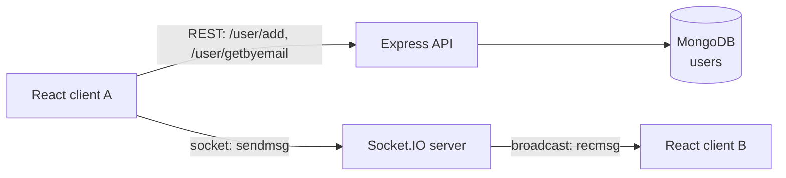

# ConnectDesk

A real-time chat app: React and Material UI on the front, Express, Socket.IO and MongoDB behind it.


## 📖 About

ConnectDesk lets people register, sign in and chat with everyone online in real time. I built it to learn the MERN stack end to end and to see how WebSockets differ from plain REST calls. Accounts go through a small REST API backed by MongoDB. Messages travel over a Socket.IO connection.

## ✨ Features

- **Landing page** with a call to action and a nav bar for Home, Register, Login and Chat (`home.js`, `header.js`)
- **Registration** form built with Formik: first and last name, date of birth, mobile, email and password. It posts to `POST /user/add` and confirms with a SweetAlert2 dialog (`Register.js`)
- **Login** that looks the user up through `GET /user/getbyemail/:email`, shows success or error alerts, and redirects to the chat (`Login.js`)
- **Live chat room**: sending emits `sendmsg`, the server re-broadcasts it as `recmsg` to every other client, and bubbles are styled as sent or received with `clsx` (`Chat.js`, `Chat.css`)
- **Mongoose user model** with name, DOB, mobile, email and password fields (`models/userModel.js`)
- CORS locked to the React dev origin for both the REST API and the socket server (`index.js`)

## 🧰 Tech stack

| Layer | Tools |
| --- | --- |
| Frontend | React 17 (Create React App), React Router 5, Material UI 5, Formik, SweetAlert2, socket.io-client, clsx, Bootstrap 5 and Font Awesome via CDN |
| Backend | Node.js, Express 4, Socket.IO 4, Mongoose 6, cors, nodemon |
| Database | MongoDB |

## 🏗️ Architecture



Express and Socket.IO share one HTTP server on port 5000. Account data goes over REST and is stored by Mongoose. Chat messages never touch the database. The server marks each incoming message as received and uses `socket.broadcast.emit` to push it to every other connected client, while the sender appends it locally.

```
ConnectDesk/
├── backend/
│   ├── index.js          # Express + Socket.IO on one HTTP server
│   ├── config.js         # reads MONGO_URI from the environment
│   ├── connection.js     # Mongoose connection
│   ├── models/           # userModel
│   └── routers/          # userRouter (/user/add, /user/getbyemail)
└── frontend/
    └── src/
        ├── components/   # home, header, Register, Login, Chat
        ├── media/        # welcome illustrations
        └── config.js     # api_url
```

## 🚀 Getting started

Prerequisites: Node.js 20.6+ (for `--env-file`) and a MongoDB instance, local or Atlas.

**Backend**

```bash
cd backend
npm install
cp .env.example .env      # set MONGO_URI to your own connection string
node --env-file=.env index.js
```

`.env.example`:

```
MONGO_URI=mongodb://localhost:27017/connectdesk
PORT=5000
```

**Frontend**

```bash
cd frontend
npm install
npm install react-router-dom@5   # used by the app but missing from package.json
npm start                         # http://localhost:3000
```

The frontend expects the API at `http://localhost:5000` (`src/config.js` and `src/components/Chat.js`). Open two browser windows on `/chat` to see messages arrive live.

## 💡 What I learned

- Running Express and Socket.IO on the same `http.Server` so REST and WebSocket traffic share one port and one CORS policy.
- The difference between `io.emit` and `socket.broadcast.emit`, and why the sender renders its own message locally.
- Handling forms with Formik's `values` and `handleChange` instead of a `useState` per field.
- Defining a Mongoose schema and model and exposing it through an Express router.

## 📌 Status

Built in 2024. Not actively maintained, and dependencies may need updating.

---

Built by Naman Chawla · [LinkedIn](https://www.linkedin.com/in/naman-chawla-63529b21b)
